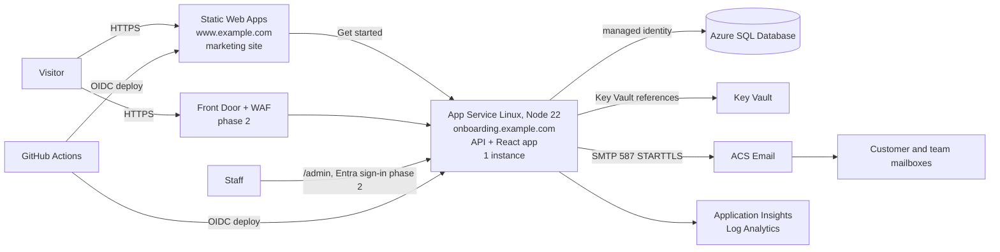

# Azure Deployment Plan: Marketing Site and Onboarding Platform

**Status:** draft for decision. **Scope:** the marketing site (`index.html`) and the onboarding platform (`platform/`).
**Last checked against the code:** the repository on branch `claude/hopeful-bell-9pfex0`.

> **How far to trust this.** Everything about *our* code (what it needs, what must change) was checked against the repository. Everything about *Azure* (SKUs, feature availability, limits, SMTP behaviour, prices) comes from general knowledge and may have changed. Section 13 lists each Azure fact to verify against current Microsoft documentation before relying on it. No cost figures are given on purpose: use the Azure Pricing Calculator for the chosen region.

---

## 1. Summary and recommendation

**Recommended target (pilot to first customers):**

| Piece | Service | Why |
|---|---|---|
| Marketing site | **Azure Static Web Apps** | A static page; cheap, global CDN, free managed certificates, deploys from GitHub |
| Onboarding platform (API + React app) | **Azure App Service (Linux, Node 22)**, one instance | The app is a single Node process that serves both the API and the built front end; App Service runs it with the least ceremony |
| Database | **Azure SQL Database** | Matches your Microsoft stack, managed backups and point-in-time restore, encryption at rest by default; replaces the local SQLite file |
| Email | **Azure Communication Services Email** (over SMTP at first) | Same cloud, domain verification with SPF/DKIM, works with the existing SMTP code |
| Secrets | **Key Vault**, read through App Service references and **managed identity** | No passwords in config or in the repo |
| Monitoring | **Application Insights + Log Analytics** | Availability test, alerts, logs with retention you control |
| Infrastructure as code | **Bicep** | Native to Azure, reviewable, repeatable |
| Delivery | **GitHub Actions** with OIDC sign-in to Azure (no stored credentials) | Tests, build, staging, approved production release |

**Two things must be true before this goes live, and both need code changes (section 4):**

1. **The database cannot stay SQLite.** The code uses a local file via `node:sqlite`. On Azure that file would sit on network-backed storage that is a poor home for SQLite, or on disposable container storage that loses data. Move to Azure SQL behind the existing `server/db.js` boundary.
2. **Run exactly one instance** until a lock is added so the email worker is safe to run twice. This is easy to enforce and cheap at pilot volume.

Everything else (Entra sign-in for staff, WAF, private networking) is a sensible phase 2.

---

## 2. Target architecture



Phase 1 can omit Front Door; App Service's own endpoint with HTTPS-only and a managed certificate is acceptable for a pilot of this size. Add Front Door and WAF when traffic or risk justifies it.

### Resource list (one set per environment)

| Resource | Notes |
|---|---|
| Resource group `rg-northbound-<env>` | Separate groups for staging and production |
| App Service plan + web app | Linux, Node 22 LTS, **HTTPS only**, TLS 1.2 minimum, always on, 1 instance |
| Azure SQL server + database | Entra-only authentication, TDE on (default), firewall closed except Azure services (phase 2: private endpoint) |
| Key Vault | RBAC mode, soft delete and purge protection on |
| ACS + Email Communication Service + verified domain | DKIM/SPF records added to DNS |
| Log Analytics workspace + Application Insights | Retention set deliberately (see section 9) |
| Static Web App | Marketing site |
| Action group + alert rules | Email/Teams to on-call |
| DNS zone (or existing DNS) | `onboarding.` and `www.`, plus email records |

---

## 3. Decisions needed before building

| # | Decision | Suggested default | Why it matters |
|---|---|---|---|
| 1 | **Azure region(s)** | One region close to most customers (for example UK South or an EU region if you serve the EU) | Fixes where personal data lives; must match `PRIVACY_NOTICE.md` sections 4 and 5 and the transfer wording |
| 2 | **Subscription layout** | One subscription, two resource groups (staging, prod) | Simple now; split later if governance needs it |
| 3 | **Domain names** | `www.<domain>` for the site, `onboarding.<domain>` for the platform | Drives certificates, `PUBLIC_URL`, the `onboarding-url` tag and email links |
| 4 | **Email sender domain** | A dedicated subdomain such as `mail.<domain>` | Isolates reputation; needs SPF, DKIM and DMARC |
| 5 | **Database tier** | General Purpose serverless **with auto-pause disabled**, or a small provisioned tier | Auto-pause makes the first request after idle slow; unacceptable for a form people fill in once |
| 6 | **Backup retention** | At least 7 days point-in-time, longer if counsel wants | Determines what the privacy notice says about backups (Part C item 12) |
| 7 | **Target recovery** | RPO 24h, RTO 1 business day for the pilot | Sets whether you need geo-redundancy now (suggest not yet) |
| 8 | **Staff sign-in** | Shared token for the first weeks; Entra ID sign-in in phase 2 | Weakest part of the current design (section 4, item 9) |
| 9 | **Who is on call** | A named person with an alerting channel | Alerts are only useful if someone gets them |

---

## 4. Code and configuration changes required

These come from reading the repository, not from Azure.

| # | Change | Detail | Effort (rough) |
|---|---|---|---|
| 1 | **Azure SQL data store** | `server/db.js` is SQLite and synchronous. The rest of the app calls about 20 store methods (`create`, `get`, `editTokenFor`, `list`, `updateAnswers`, `updateAdmin`, `deleteRequest`, `expiredIds`, the outbox methods, the audit methods). Introduce `server/store/sqlite.js` (keep for tests and local dev) and `server/store/mssql.js`, both exposing the **same async interface**, selected by a `DB_PROVIDER` setting. Convert `app.js`, `notifier.js` and `retention.js` to `await` the store. Port the schema (`INTEGER PRIMARY KEY AUTOINCREMENT` becomes `IDENTITY`, `TEXT` becomes `NVARCHAR`, `PRAGMA table_info` migrations become `sys.columns` checks, transactions use the driver's API). Use `mssql`/`tedious` with Entra (managed identity) authentication. Run one **shared contract test suite against both stores** | 3 to 5 days |
| 2 | **Single-instance guard, then a lease** | The email worker and retention job run inside the web process. Two instances would both pick the same queued email and send it twice. Phase 1: set the plan to one instance and no autoscale. Before scaling: claim outbox rows atomically (`UPDATE … OUTPUT` with a lease timestamp) or use `sp_getapplock` | 0.5 day now, 1 to 2 days later |
| 3 | **Deployment package contents** | `server/notice.js` reads `web/src/privacy-notice.md` **at runtime** to fingerprint the notice, so that file must ship with the app along with `server/`, `dist/`, production `node_modules` and `package.json`. Build with `npm ci && npm run build` (the build regenerates the notice from `../PRIVACY_NOTICE.md`, so build from the repository root checkout) | 0.5 day (CI) |
| 4 | **Proxy trust and the rate limiter** | The submission limiter keys on `req.ip`. Behind App Service (and later Front Door) the real client is in `X-Forwarded-For`. Set `TRUST_PROXY` to the correct number of hops and **test after deploy** that spoofing the header does not bypass the limit. The limiter is per instance and in memory, fine for one instance | 0.5 day |
| 5 | **Rate-limit admin sign-in attempts** | Only `POST /api/requests` is limited today; wrong admin tokens can be tried without limit. Add a limiter and short lockout on `/api/admin/*` failures, and use a long random token from Key Vault | 0.5 day |
| 6 | **Health and readiness** | `/api/health` returns OK without touching the database. Add a readiness check that runs a trivial query, for App Service health checks and the availability test | 0.5 day |
| 7 | **Production safety checks at startup** | Refuse to start in production if `MAIL_TRANSPORT=log` (it prints full email text to the console: Part C item 6 of the privacy notice), if `ADMIN_TOKEN` is unset or short, or if `PUBLIC_URL` is not HTTPS | 0.5 day |
| 8 | **Structured logging, no personal data** | Replace `console.*` with a small logger that writes JSON to stdout (App Service forwards to Log Analytics). Never log request bodies, names or emails. Add request IDs | 1 day |
| 9 | **Staff sign-in with Entra ID** (phase 2) | Options: App Service Authentication (Easy Auth) covering `/admin` and `/api/admin/*` with the public routes excluded, or code-level OIDC. Gives named users and a real audit trail instead of one shared token | 2 to 3 days |
| 10 | **Security headers** | Add `Content-Security-Policy` (default `self`), `Strict-Transport-Security`, `Permissions-Policy`. The privacy page injects HTML rendered from our own static notice, so keep it that way and keep CSP strict | 0.5 day |
| 11 | **Edit-token expiry and hashing** | From the privacy notice Part C item 5; do before launch if counsel agrees | 0.5 day |
| 12 | **Static Web Apps config for the marketing site** | Add `staticwebapp.config.json` with security headers and a 404 page | 0.25 day |
| 13 | **Replace the placeholder `onboarding-url`** in `index.html` (currently `http://localhost:3001/`) and fix the placeholder `hello@example.com` addresses | 0.25 day |

---

## 5. Configuration and secrets

App Service **application settings**, with secrets as **Key Vault references** (`@Microsoft.KeyVault(SecretUri=…)`) resolved through the app's managed identity:

| Setting | Source | Notes |
|---|---|---|
| `NODE_ENV` | `production` | Set by the start script too |
| `PORT` | Injected by App Service | The app already reads `PORT` (verify the value App Service passes) |
| `PUBLIC_URL` | App setting | `https://onboarding.<domain>` |
| `TRUST_PROXY` | App setting | Number of proxy hops; test it |
| `ADMIN_TOKEN` | Key Vault | Long random; rotate on staff changes |
| `DB_PROVIDER`, `SQL_SERVER`, `SQL_DATABASE` | App settings | No password: managed identity |
| `MAIL_TRANSPORT` | `smtp` | Never `log` in production |
| `SMTP_HOST`, `SMTP_PORT`, `SMTP_USER` | App settings | ACS SMTP endpoint, 587 |
| `SMTP_PASS` | Key Vault | ACS credential |
| `MAIL_FROM`, `MAIL_REPLY_TO`, `NOTIFY_TO` | App settings | Verified sender; `NOTIFY_TO` should be a **shared mailbox** with a retention rule (privacy notice Part C item 11) |
| `RETENTION_DAYS` | App setting | `365` unless counsel decides otherwise |
| `APPLICATIONINSIGHTS_CONNECTION_STRING` | App setting | Not secret, but not public either |

**Identity and access:**

- Web app **system-assigned managed identity** gets: *Key Vault Secrets User* on the vault, and a **contained database user** in Azure SQL with only the permissions the app needs (read/write on its own tables; no schema changes in production, which run from the pipeline).
- GitHub Actions deploys using a **federated credential** (OIDC), scoped to the resource group, not a stored secret.
- Humans use Entra groups with Azure RBAC (reader by default; contributor via time-limited elevation).

---

## 6. Environments and release flow

| Environment | Purpose | Data |
|---|---|---|
| **local** | Development (`npm run dev`, SQLite) | Fake |
| **staging** | Pre-release checks, accessible only to the team; same shape as production | Fake or test data only. Never copy production personal data here |
| **production** | Customers | Real |

**Pipeline (GitHub Actions):**

1. **Pull request:** `npm ci`, `npm test` (both stores in the contract suite), `npm run build`, Bicep `what-if`, secret scanning. Required to merge.
2. **Merge to main:** build the package, deploy to **staging** (App Service deployment slot or a separate app), run a smoke test: submit a request, check the confirmation email path (log capture or a test mailbox), export, delete.
3. **Production release:** manual approval, deploy to a **staging slot** of the production app, warm up, health check, **swap**. Keep the previous slot for fast rollback.
4. **Database changes:** applied by the pipeline before the swap, additive first (new columns, then code, then removal later) so the old and new versions both work during the swap.

Outline of the infrastructure folder to add (not yet created):

```
infra/
  main.bicep            # composes the modules below
  modules/{appservice,sql,keyvault,acs,monitoring,staticwebapp}.bicep
  parameters/{staging,prod}.bicepparam
.github/workflows/{ci.yml,deploy.yml}
```

---

## 7. Email

- Create an **Azure Communication Services Email** resource and a custom **verified domain** (a dedicated subdomain). Add the SPF and DKIM records it provides, and a **DMARC** record starting at `p=none`, moving to `quarantine` once reports look clean.
- The existing code sends through SMTP (`nodemailer`). Azure Communication Services offers an SMTP endpoint authenticated with an Entra application credential; use it first so no email code changes are needed. If SMTP proves awkward, add a small `acs` transport using the ACS SDK instead.
- Do **not** plan on Microsoft 365 "SMTP AUTH" with a mailbox password: Microsoft has been moving away from basic authentication for it. (Verify current status.)
- Send a test through the real path from staging, and check headers (SPF, DKIM and DMARC pass) and spam placement before launch.
- Configure bounce and complaint handling: at minimum a monitored `MAIL_REPLY_TO` mailbox and an alert when `outbox` rows are failed (section 9).
- The team alert mailbox is where personal data from alerts accumulates: use a **shared mailbox** with a retention policy that matches the privacy notice.

---

## 8. Security and compliance

**Baseline (phase 1):**

- HTTPS only, TLS 1.2+, HSTS; FTP disabled; remote debugging off; SCM site access restricted.
- Azure SQL: Entra-only authentication, TDE on, auditing to Log Analytics, firewall allowing only the app (and a named admin IP during setup), no public access to storage.
- Key Vault with RBAC, soft delete and purge protection; no secrets in app settings in plain text.
- Microsoft Defender for Cloud basics enabled; recommendations reviewed monthly.
- Dependabot or equivalent on `npm`, plus `npm audit` in CI.
- Admin endpoints limited and logged (sections 4.5 and 4.9).

**Phase 2:** Front Door with WAF and rate limiting at the edge, private endpoints for SQL and Key Vault (VNet integration), Entra sign-in for staff, geo-redundant backups, Defender for SQL.

**Alignment with the privacy documents:**

- Region(s) chosen in section 3 must be stated in `PRIVACY_NOTICE.md` sections 4 and 5. Microsoft acts as a processor: record the Microsoft data processing terms you rely on and list Microsoft as a provider in the notice.
- Backup retention (decision 6) and log retention (section 9) become the statements in notice section 6 and Part C items 9 and 12.
- The retention job (`RETENTION_DAYS`) and the deletion and export features already exist; confirm in staging that deletion removes rows and that the deleted data is gone from queries, then document that backups age out on the SQL retention schedule.
- Incident handling follows `DPA.md` (72 hours) and `AI_POLICY.md` section 10; add the Azure-side steps to the runbook (section 9).

---

## 9. Operations

**Monitoring and alerts:**

| Alert | Condition | Action |
|---|---|---|
| Availability | Availability test on `/api/health` (and readiness) fails from 2+ locations | Page on-call |
| Server errors | 5xx rate above a threshold | Investigate |
| Failed emails | Any `outbox` row with status `failed`, or `pending` older than 30 minutes | Check ACS and DNS; retry from `/admin` |
| Database | CPU or DTU high, storage near limit, deadlocks | Scale or investigate |
| Certificates and secrets | Expiry within 30 days | Rotate |
| Security | Repeated admin sign-in failures, unusual request spikes | Review, block |
| Cost | Budget alert at 80% of the monthly budget | Review |

Log retention in Log Analytics should be set deliberately (for example 30 to 90 days) and match the privacy notice.

**Backups and recovery:** Azure SQL point-in-time restore is automatic; set retention per decision 6. Restore into a **separate** database quarterly to prove it works, and time it against the RTO. Redeploying the app is a pipeline run, so there is no app state to back up. Remember that a restore re-creates data that was deleted after the restore point, so after any restore re-run the retention job and re-apply recent deletion requests.

**Runbooks to write before launch (one page each):**

1. Site is down
2. Emails are not arriving or are in spam
3. Rotate secrets (`ADMIN_TOKEN`, ACS credential)
4. Restore the database (and the deletion re-apply step)
5. A deletion or export request from a person
6. Suspected data breach (notification clock, who decides, templates)
7. Deploy and roll back

**Routine:** monthly dependency and Defender review, quarterly restore test, quarterly access review.

---

## 10. Rollout plan

| Phase | Work | Exit criteria | Rough effort |
|---|---|---|---|
| **0. Decisions** | Section 3 decisions; domain and sender chosen; counsel confirms region and processor wording | Decisions recorded | 1 day |
| **1. Foundations** | Bicep for staging: resource group, App Service, SQL, Key Vault, ACS, monitoring; DNS and email records | Empty staging app reachable over HTTPS; test email passes SPF, DKIM, DMARC | 2 to 3 days |
| **2. Code changes** | Section 4 items 1 to 8, 10 to 13 | Contract tests green on SQLite and Azure SQL; app runs against Azure SQL with managed identity | 6 to 9 days |
| **3. Delivery pipeline** | CI, staging deploy with smoke test, production slot swap with approval | A full release from merge to production-ready with rollback tested | 1 to 2 days |
| **4. Hardening and rehearsal** | Alerts, runbooks, restore test, load test of the submission form, penetration-style review of admin and export/delete endpoints, accessibility check | Checklist in section 11 complete | 2 to 3 days |
| **5. Soft launch** | Production deploy; marketing site pointed at production onboarding URL; real but low traffic | One week with no sev-1 issues; first real request processed end to end | 1 week elapsed |
| **6. Phase-2 hardening** | Entra staff sign-in, Front Door + WAF, private endpoints, lease for multi-instance | Per section 8 | 1 to 2 weeks |

Effort figures are rough single-developer estimates and exclude waiting on counsel, DNS and domain verification.

---

## 11. Go-live checklist

**Product and legal**
- [ ] Privacy notice final: placeholders filled, draft banner gone (`npm run sync:privacy`), region and providers listed
- [ ] Consent text and links verified on the form, footer, confirmation email and marketing site
- [ ] `onboarding-url` and every `example.com` address replaced
- [ ] DPA, NDA and MSA references checked for any promise the live system must support

**Infrastructure and security**
- [ ] HTTPS-only, TLS 1.2+, HSTS, custom domains with managed certificates
- [ ] No secrets in the repo or plain app settings; Key Vault references working
- [ ] Managed identity access to SQL and Key Vault; no SQL passwords exist
- [ ] SQL firewall closed except the app; auditing on
- [ ] `MAIL_TRANSPORT=smtp`, startup safety checks pass, `ADMIN_TOKEN` long and random
- [ ] `TRUST_PROXY` verified by test; both limiters work

**Function**
- [ ] Staging smoke test passes: submit, confirmation and team emails, sharpen, download, delete, admin export, admin delete, retention job on a test row
- [ ] Production smoke test the same, with a real mailbox
- [ ] Emails pass SPF, DKIM and DMARC and reach inbox, not spam

**Operations**
- [ ] Alerts firing to a person; availability test green
- [ ] Runbooks written; restore tested once
- [ ] Budget alert set; owner for monthly review assigned
- [ ] Rollback rehearsed

---

## 12. Alternatives considered

| Option | Verdict |
|---|---|
| **SQLite on App Service storage** | Rejected for production. The persistent path is network-backed storage, which is a poor fit for SQLite locking and durability; anything else is lost on restart or scale. Fine for local development and tests |
| **Azure Container Apps** | A good alternative (and better if scale-to-zero or jobs matter). Needs a container build; the worker/retention could become scheduled jobs. Revisit if the platform grows beyond one app |
| **Static Web Apps with managed Functions for the API** | Attractive for cost, but means rewriting Express routes as functions and the email worker as a timer; not worth it yet |
| **AKS** | Overkill for one small service |
| **Azure Database for PostgreSQL Flexible Server** | Fully viable and portable; chosen against only because the rest of the stack is Microsoft and the team can reuse SQL skills |
| **Microsoft 365 mailbox via SMTP AUTH** | Avoid: basic-auth dependence, mailbox lifecycle, sending limits |

---

## 13. Azure facts to verify before relying on them

1. Which Node versions App Service Linux supports now (plan assumes Node 22 LTS), and the value of the `PORT` variable it injects.
2. How ACS Email's SMTP endpoint authenticates today (credential format, port 587, STARTTLS) and its sending limits and throttling, including any approval steps for new sending domains.
3. Current status of basic authentication for Exchange Online SMTP AUTH, if that route is ever considered.
4. Azure SQL serverless auto-pause behaviour and whether it can be disabled on the chosen tier; the cold-start delay after a pause.
5. Managed-identity authentication from the `mssql`/`tedious` driver (supported authentication types and package versions).
6. App Service Authentication ("Easy Auth") ability to exclude specific paths while protecting others, if used for `/admin`.
7. Static Web Apps limits on custom domains, headers configuration and the plan needed for them.
8. Deployment slot availability on the chosen App Service plan tier (needed for the swap release flow).
9. Point-in-time restore retention limits and defaults for the chosen SQL tier.
10. Pricing for every resource in the chosen region, using the Azure Pricing Calculator.

---

## 14. Risks and open questions

| Risk | Mitigation |
|---|---|
| Azure SQL port introduces bugs in a data-protection-sensitive path (deletion, export) | Shared contract tests on both stores; staging smoke test; deletion verified by query |
| Email lands in spam or throttles | SPF/DKIM/DMARC, dedicated sender subdomain, test before launch, monitor failed outbox rows |
| A second instance starts (autoscale, slot overlap) and duplicates emails | One instance enforced in Bicep; lease before scaling; slot swap keeps staging slot's settings non-sticky, check for overlap |
| Shared admin token leaks or is guessed | Key Vault storage, rate limiting, rotation runbook, Entra sign-in in phase 2 |
| Cost surprises (serverless DB, logs, WAF) | Budget alerts, log retention, review the first two invoices |
| Counsel changes the notice after launch | Notice is generated from one file; the page and consent fingerprint update on the next deploy |
| Region choice conflicts with a client's data-residency demand | Decide region with sales input; note per-client residency is a separate deployment, not a setting |

**Open questions for you:** the region(s) and domains; whether staff sign-in must be Entra from day one; who is on call; whether the marketing site and platform should share one domain with path routing (simpler certificates, harder separation) or stay on separate hostnames (recommended).
