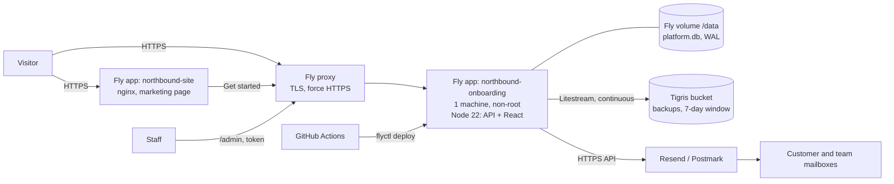

# Fly.io Deployment Plan: Marketing Site and Onboarding Platform

**Status:** the code and configuration are in the repository; nothing has been deployed to Fly.io yet.
**Replaces** the earlier Azure plan (still in git history). Fly.io suits this app better: SQLite on a Fly volume with continuous backup removes the need to port the database, and the whole setup is a handful of commands.

> **How far to trust this.** Section 11 says exactly what was tested here and what was not. Facts about Fly.io itself (limits, pricing, syntax, defaults) come from general knowledge and may have changed; section 12 lists each one to verify against the current Fly.io documentation before relying on it. No prices are given on purpose.

---

## 1. Summary

| Piece | Where | How |
|---|---|---|
| Onboarding platform (API + React app) | **Fly.io app** `northbound-onboarding`, **one machine** | `platform/Dockerfile`, `platform/fly.toml` |
| Database | **SQLite on a Fly volume** mounted at `/data` | WAL mode; unchanged code path |
| Backups | **Litestream** replicating continuously to **Tigris** object storage (S3-compatible, created with `fly storage create`) | Restores automatically onto an empty volume |
| Email | **Resend or Postmark over HTTPS** | New transports; SMTP is also still supported |
| Secrets | `fly secrets set` | Never in the repo or `fly.toml` |
| Marketing site | A second small Fly app (nginx), or any static host | `site/` |
| Delivery | GitHub Actions: tests on every change, deploy from `main` | `.github/workflows/platform.yml` |

**Why one machine:** the SQLite volume belongs to a single machine, and the email queue and retention job run inside the app, so a second copy would send emails twice. One machine is plenty for an enquiry form. The trade-off is a few seconds of downtime during each deploy and no automatic failover; Litestream means a lost machine or volume is recovered by starting a new one, not by restoring by hand.

---

## 2. Architecture



---

## 3. What was changed in the code for Fly.io (done)

| Change | Why |
|---|---|
| `platform/Dockerfile`: two stages (build the React app; slim Node runtime), Litestream copied from its official image, `ca-certificates` installed, runs as the non-root `node` user | Reproducible image; Litestream needs system certificates to talk to the bucket (the slim image has none: a bug found while testing) |
| `platform/docker-entrypoint.sh` | Fixes ownership of the volume, restores the database from the backup if the volume is empty, then runs the app under Litestream so every change is replicated |
| `platform/litestream.yml` | Replica to Tigris via the secrets `fly storage create` provides; 7-day retention; daily snapshots |
| `platform/fly.toml` | App, region, volume mount, HTTPS-only, never auto-stop, health check on `/api/ready`, SIGINT with 30 s to shut down cleanly |
| `server/db.js`: WAL mode, busy timeout, `ping()` | Litestream requires WAL; readiness check |
| `GET /api/ready` | Fly's health check: fails if the database is unreachable (`/api/health` stays as a plain liveness check) |
| `server/mail.js`: `resend` and `postmark` transports | Fly.io restricts outbound SMTP (verify which ports), so email goes over HTTPS. Permanent rejections (bad address, bad key, unverified domain) are not retried; rate limits and provider outages are |
| `server/config.js` + `server/index.js` | In production the app **refuses to start** if `MAIL_TRANSPORT=log` (it would print personal data to logs), `PUBLIC_URL` is not `https://`, `NOTIFY_TO` is empty, or `ADMIN_TOKEN` is under 24 characters |
| **Staff sign-in (OpenID Connect)** | Named accounts instead of one shared token: Entra ID, Google or Okta, an email allowlist, server-side sessions, CSRF protection and a per-person activity log (`platform/README.md`, Staff sign-in). The shared token is off once it is configured |
| Admin sign-in limiter | Ten wrong tokens per address per 15 minutes locks that address out of `/api/admin`; sign-in attempts are limited too |
| Security headers | Content-Security-Policy (everything from this origin only), HSTS in production, Permissions-Policy |
| `site/` (Dockerfile, nginx config, `fly.toml`, `deploy.sh`) | Marketing page on Fly with security headers |
| `.github/workflows/platform.yml` | Test and build on every change; deploy from `main` |

Tests: 52 pass, including staff sign-in against a fake provider and attack cases, and the mail transports against fake HTTP servers, production checks, readiness, headers, the admin lockout and WAL mode.

---

## 4. Decisions needed before deploying

| # | Decision | Suggested default | Why it matters |
|---|---|---|---|
| 1 | **Fly region** (`primary_region`) | One close to most customers (for example `lhr` for the UK) | Where personal data lives; must match the privacy notice |
| 2 | **Fly app names** | `northbound-onboarding`, `northbound-site` (names are global; change if taken) | Hostnames, secrets, CI |
| 3 | **Domains** | `www.<domain>` for the site, `onboarding.<domain>` for the platform | Certificates, `PUBLIC_URL`, the site's `onboarding-url` tag |
| 4 | **Email provider and sender domain** | Resend or Postmark, sending from a subdomain such as `mail.<domain>` | Needs SPF, DKIM and DMARC records |
| 5 | **Where the marketing site lives** | A second Fly app (included) or any static host (GitHub Pages, Cloudflare Pages) | Fly is simplest to keep in one place |
| 6 | **Backup retention** | 168 hours (7 days), set in `litestream.yml` | Deleted data stays in backups this long; the privacy notice must say so |
| 7 | **Who is on call, and how they are alerted** | A named person | Alerts are only useful if someone gets them |
| 8 | **Identity provider for staff sign-in** | **Google** (free, quickest; ask staff to enable 2-Step Verification). Move to Microsoft Entra ID with security defaults if you want MFA enforced for you | Needs an OAuth client, the redirect URI and an allowlist; see `platform/README.md` and run `npm run check:auth` |

---

## 5. First deployment, step by step

Run from `platform/` unless stated. Replace the example names and domains.

```bash
# 0. One-off
curl -L https://fly.io/install.sh | sh
fly auth login

# 1. Create the app and its single volume (same region as primary_region in fly.toml)
fly apps create northbound-onboarding
fly volumes create northbound_data --app northbound-onboarding --region lhr --size 1

# 2. Backup bucket on Tigris. This also sets BUCKET_NAME, AWS_ENDPOINT_URL_S3,
#    AWS_REGION and the access keys as secrets on the app.
fly storage create --app northbound-onboarding

# 3. Secrets (the email API key comes from Resend or Postmark after you verify your domain)
fly secrets set --app northbound-onboarding \
  OIDC_ISSUER="https://accounts.google.com" \
  OIDC_CLIENT_ID="....apps.googleusercontent.com" \
  OIDC_CLIENT_SECRET="..." \
  ADMIN_EMAILS="you@example.com,colleague@example.com" \
  SESSION_SECRET="$(openssl rand -hex 32)" \
  MAIL_API_KEY="..." \
  MAIL_FROM="Northbound <onboarding@mail.example.com>" \
  MAIL_REPLY_TO="hello@example.com" \
  NOTIFY_TO="hello@example.com"

# 4. Edit fly.toml: app name, primary_region, PUBLIC_URL (and MAIL_TRANSPORT if using postmark)

# 5. Deploy exactly one machine
fly deploy --ha=false

# 6. Check it
fly status
curl https://northbound-onboarding.fly.dev/api/ready      # {"ok":true}
fly logs                                                  # no "ERROR" lines from litestream

# 7. Custom domain
fly certs add onboarding.example.com                      # then add the DNS records it prints
```

### The same steps in Windows PowerShell

The bash block above uses `$(openssl …)`, which does not work in PowerShell. Run these from `C:\moc\moc\platform`, replacing `<app>` with your app name (it must be unique across Fly) and the other `<…>` values:

```powershell
# 0. One-off: install the Fly CLI, then open a new PowerShell window and sign in
iwr https://fly.io/install.ps1 -useb | iex
fly auth login

# 1. Edit fly.toml first: app, primary_region, and PUBLIC_URL = "https://<app>.fly.dev"
notepad fly.toml

# 2. App, volume and backup bucket
fly apps create <app>
fly volumes create northbound_data --app <app> --region lhr --size 1
fly storage create --app <app>          # sets BUCKET_NAME, AWS_* secrets for you

# 3. A fresh SESSION_SECRET (keep this output private; use it in the next command)
node -e "console.log(require('crypto').randomBytes(32).toString('hex'))"

# 4. Secrets (double quotes keep spaces and < > intact)
fly secrets set --app <app> `
  "OIDC_ISSUER=https://accounts.google.com" `
  "OIDC_CLIENT_ID=<id>.apps.googleusercontent.com" `
  "OIDC_CLIENT_SECRET=<secret>" `
  "ADMIN_EMAILS=you@gmail.com,colleague@gmail.com" `
  "SESSION_SECRET=<value from step 3>" `
  "MAIL_API_KEY=<resend or postmark key>" `
  "MAIL_FROM=Northbound <onboarding@resend.dev>" `
  "MAIL_REPLY_TO=you@gmail.com" `
  "NOTIFY_TO=you@gmail.com"

# 5. Deploy exactly one machine
fly deploy --ha=false

# 6. Check
fly status --app <app>
curl.exe https://<app>.fly.dev/api/ready
fly logs --app <app>
```

Before step 5, add `https://<app>.fly.dev/auth/callback` as an authorized redirect URI on your Google OAuth client.

**First test without a verified email domain:** Resend's test sender (`onboarding@resend.dev`) can only send to the email address of your Resend account, so for a first end-to-end test use that same address for `NOTIFY_TO`, `MAIL_REPLY_TO`, and as the "customer" email you type into the form. Verify a real domain (SPF/DKIM records) before inviting anyone else to use the form.

**What a healthy start looks like in `fly logs`:** `Admin: staff sign-in via https://accounts.google.com`, `Email: sending via resend`, and no lines containing `level=ERROR`. If the app exits straight away, the log starts with `Refusing to start in production:` followed by the exact settings to fix.

Then:

1. **Email domain:** add the SPF and DKIM records your provider shows, and a DMARC record (start with `p=none`, move to `quarantine` after a few clean weeks). Send a real test; check the headers show SPF, DKIM and DMARC passing and the message reaches the inbox.
2. **Marketing site:** `cd ../site && ./deploy.sh` (after editing `site/fly.toml`), then `fly certs add www.example.com --app northbound-site`.
3. **Link the two:** set the `onboarding-url` tag in `index.html` to the real address, replace the placeholder `hello@example.com` addresses, redeploy the site.
4. **Privacy notice:** fill in the placeholders in `PRIVACY_NOTICE.md` (hosting provider, backup storage, email provider, region), run `npm run sync:privacy`, redeploy. The draft banner disappears when no `{{placeholders}}` remain.
5. **CI deploys:** `fly tokens create deploy --app northbound-onboarding`, add the output as the GitHub secret `FLY_API_TOKEN`. Merges to `main` that touch `platform/` then test and deploy.

---

## 6. Configuration

Set in `fly.toml` (not secret) or with `fly secrets set` (secret):

| Variable | Where | Notes |
|---|---|---|
| `PORT`, `DB_PATH`, `NODE_ENV` | `fly.toml` / image | `8080`, `/data/platform.db`, `production` |
| `PUBLIC_URL` | `fly.toml` | Must be `https://…` in production |
| `TRUST_PROXY` | `fly.toml` | `1` (Fly's proxy is one hop). **Test after deploy** that a forged `X-Forwarded-For` does not bypass the submission limit |
| `RETENTION_DAYS` | `fly.toml` | `365`; `0` disables |
| `MAIL_TRANSPORT` | `fly.toml` | `resend` or `postmark` (`smtp` if your host allows it; `log` is refused in production) |
| `OIDC_ISSUER`, `OIDC_CLIENT_ID`, `OIDC_CLIENT_SECRET`, `ADMIN_EMAILS`, `SESSION_SECRET` | secret | Staff sign-in. Register `https://<PUBLIC_URL host>/auth/callback` with the provider. `SESSION_SECRET` is 32+ random characters |
| `ADMIN_TOKEN` | secret, optional | Only for the first deploy or break-glass; ignored once sign-in is configured unless `ALLOW_ADMIN_TOKEN=true`. At least 24 characters |
| `MAIL_API_KEY` | secret | Resend or Postmark key |
| `MAIL_FROM`, `MAIL_REPLY_TO`, `NOTIFY_TO` | secret | `NOTIFY_TO` should be a shared mailbox with a retention rule (privacy notice Part C item 11) |
| `BUCKET_NAME`, `AWS_*` | secret (set by `fly storage create`) | If `BUCKET_NAME` is missing the app still starts but warns loudly that it is **not backed up** |

---

## 7. Environments and releases

| Environment | Purpose |
|---|---|
| **local** | `npm run dev` with SQLite and `MAIL_TRANSPORT=log` |
| **staging** | A second app, `northbound-onboarding-staging`, with its own volume, bucket and secrets. Set `NODE_ENV=staging` in its config so the production checks do not apply; use a test mailbox and **fake data only**. Never copy production data into staging |
| **production** | Customers |

**Release flow:** pull request runs tests and the build; merge to `main` deploys. A single machine means a **few seconds of downtime per deploy**; deploy at quiet times, and the form's own retry (the person can resubmit) covers the rare failure. Roll back with `fly releases` and redeploy the previous image (`fly deploy --image <ref>`). Database changes must stay **additive** (new columns first) so a rollback to the previous image still works against the migrated database.

---

## 8. Backups and recovery

| Layer | What it gives you |
|---|---|
| **Litestream → Tigris** | Continuous replication (seconds of data at risk), 7-day point-in-time window, daily snapshots. Survives losing the machine or the volume |
| **Fly volume snapshots** | A second layer taken by the platform (verify frequency and retention) |
| **Redeploy** | The app is stateless apart from the database, so redeploying needs no backup |

**Proven here** (against a local replica, not Tigris): a request was created, the volume was wiped, a fresh container started, restored the database automatically, and the request was there. Shutdown with SIGINT exited cleanly.

**Recovery runbook:**

1. *Lost machine or volume:* `fly volumes create northbound_data --region lhr --size 1`, then `fly machine run`/`fly deploy --ha=false` as at first deploy. The entrypoint restores from Tigris on first start. Check `fly logs` for "restoring snapshot".
2. *Restore to an earlier moment* (corruption, bad deploy): `fly ssh console`, stop the app, `litestream restore -timestamp <time> -o /data/platform.db …` (see Litestream docs), restart.
3. *After any restore*, re-check recent deletion and export requests: a restore to an earlier point brings back data that was deleted later. The retention job will re-run within a day, but **individual deletion requests made after the restore point must be re-applied by hand**. Keep the deletion confirmations (audit entries are in the database, so also keep the `fly logs` or an external note).
4. **Test a restore into a scratch app every quarter** and time it.

**Backup monitoring:** Litestream errors do **not** stop the app (verified: a misconfigured replica logged errors every second while the app kept serving). Ship logs somewhere that can alert on `level=ERROR` from litestream and on the "BUCKET_NAME is not set" warning. A backup that silently stopped is the worst failure in this design.

**Privacy:** deleted data remains in backups for the retention window (default 7 days). State this in the privacy notice (Part C item 12).

---

## 9. Security

**In place:** HTTPS only (Fly proxy, `force_https`) plus HSTS; non-root container; secrets only in `fly secrets`; production refuses unsafe config; CSP and other headers; submission and admin-login rate limits; deletion, export and retention with an audit log; private backup bucket.

**To arrange:**

- **Fly organisation hygiene:** two-factor authentication for everyone, minimum members, **deploy tokens scoped to the single app**. Anyone who can use `fly ssh console` can read the database, so treat org access as access to personal data.
- **Tigris bucket** must be private; keys are created per app by `fly storage create`.
- **Email domain:** SPF, DKIM, DMARC (section 5).
- **Dependency hygiene:** Dependabot or similar on `npm`, `npm audit` in CI, and rebuild the image periodically for base-image patches.
- **Staff sign-in:** built (OpenID Connect). Review the `ADMIN_EMAILS` list quarterly, require MFA at the identity provider (Conditional Access in Entra), remove the shared token (`fly secrets unset ADMIN_TOKEN`) once sign-in works, and watch the activity log and `login-failed` entries. Break-glass if the identity provider is down: set `ALLOW_ADMIN_TOKEN=true` with a fresh `ADMIN_TOKEN`, then remove them again.
- **Static marketing page CSP** allows inline script and style because the page has one of each; moving them to files would allow a strict policy.

**Data protection alignment** (for counsel):

- Region must match `PRIVACY_NOTICE.md` sections 4 and 5. The providers to list there: **Fly.io** (hosting), **Tigris** (backup storage), the **email provider**, and **GitHub** if it holds the code only (no personal data). Each needs data processing terms on file.
- Retention: `RETENTION_DAYS` for live data plus the backup window for deleted data.
- Logs: Fly's own log retention is short (verify); if you ship them elsewhere, that destination is also a provider and its retention goes in the notice. The app does not log request contents, names or emails.
- Incident handling follows `DPA.md` (72 hours) and `AI_POLICY.md` section 10.

---

## 10. Operations

**Checks and alerts:**

| Alert | How |
|---|---|
| Down | External uptime monitor on `https://onboarding.../api/ready` and the marketing page (Fly's own health check restarts a failing machine but does not page anyone) |
| Backup trouble | Log alert on litestream errors; quarterly restore test |
| Failed emails | `/admin` shows failed email records per request; add an alert on repeated `failed`/`giving up` log lines |
| Disk | `fly ssh console -C "df -h /data"` monthly, or an alert from log shipping; extend with `fly volumes extend` |
| Admin lockouts and error spikes | Log alerts |

**Runbooks to write (one page each):** site down; emails not arriving or in spam; rotate `ADMIN_TOKEN` and the email API key; restore (section 8); handle a person's deletion or export request; suspected data breach; deploy and roll back.

**Scaling:** increase machine size with `fly scale vm` and `fly scale memory`. **Do not add machines** until two things exist: an outbox claim/lease so two workers cannot send the same email, and a database that more than one machine can use (LiteFS or a managed Postgres). Neither is needed at enquiry-form volume.

**Cost levers:** one small machine, a 1 GB volume, a bucket, and possibly a dedicated IPv4 address (verify whether you need one; shared addresses are normally included). Set a budget alert.

---

## 11. What was tested here, and what was not

**Tested:**

- 40 automated tests pass, including the new mail transports (against fake HTTP servers), production safety checks, readiness, security headers, admin lockout and WAL mode.
- Browser run of the real flow with the new Content-Security-Policy: privacy page, download, delete, admin export and delete; **no console errors**.
- The **runtime stage of the image** (same Dockerfile stages, built from the host's build output): runs as non-root, fixes volume ownership, refuses an unsafe production config with clear messages, serves `/api/ready`, replicates with Litestream, exits cleanly on SIGINT, and **restores a request onto a wiped volume**.

**Not tested (be honest with yourself about these):**

- The full `docker build` from scratch: container builds in this sandbox cannot reach the npm registry. (The first build attempt also showed the missing CA certificates, which is now fixed in the Dockerfile.) The first real `fly deploy` will be the first full build.
- Anything on Fly.io itself: `fly.toml` syntax and behaviour, volumes, health checks, the proxy, certificates, `TRUST_PROXY=1` with Fly's headers.
- Litestream to **Tigris** (the test used a local file replica, so credentials, endpoint and region settings are unproven).
- **Live** Resend or Postmark delivery, domain verification, spam placement.
- Staff sign-in against a **real** identity provider (Entra, Google). It was tested against a stand-in that follows the standard flow; claim names, issuer format and consent screens in your tenant are unproven.
- The GitHub Actions workflow and the `site/` deploy script.

Plan a rehearsal on a staging app that exercises each of these before production.

---

## 12. Fly.io facts to verify

1. Which outbound SMTP ports Fly restricts (the plan avoids SMTP either way).
2. `fly.toml` keys and values used: `auto_stop_machines = false` (some versions use `"off"`), `[[http_service.checks]]`, `[mounts]`, `kill_signal`, `kill_timeout`, `min_machines_running`.
3. That `fly deploy --ha=false` gives exactly one machine, and how deploys behave for a single machine with a volume (downtime length).
4. What `fly storage create` sets exactly (`BUCKET_NAME`, `AWS_ENDPOINT_URL_S3`, `AWS_REGION`, keys) and that they match `litestream.yml`.
5. Litestream 0.3.13 behaviour: environment-variable expansion in the config, `retention` and `snapshot-interval` keys, and S3-compatible settings for Tigris (path-style or virtual-host addressing).
6. Fly volume snapshot frequency and retention, and encryption at rest of volumes and of Tigris buckets (the privacy notice section 7 should only claim what is verified).
7. What the Fly proxy sends for client IPs, and that `TRUST_PROXY=1` is right.
8. Pricing: machines, volumes, Tigris storage and requests, dedicated IPv4, bandwidth.
9. Region codes and which regions fit your data-location needs.
10. Resend and Postmark: domain verification steps, sending limits, API request formats (the code follows their documented JSON APIs, tested only against fakes).

---

## 13. Go-live checklist

**Legal and product**
- [ ] Privacy notice final: placeholders filled (hosting, backup storage, email provider, region), draft banner gone
- [ ] Data processing terms on file for Fly.io, Tigris and the email provider
- [ ] `onboarding-url` and every `example.com` address replaced
- [ ] Notice states the backup window for deleted data

**Platform**
- [ ] One machine, one volume, one region; `fly status` healthy
- [ ] `BUCKET_NAME` set; no litestream errors in `fly logs`; a **restore rehearsal passed**
- [ ] Secrets set; app starts in production mode (the safety checks pass, no startup warnings)
- [ ] Staff sign-in works against the real identity provider (allowed person in, others refused, MFA enforced), and `ADMIN_TOKEN` removed
- [ ] `TRUST_PROXY` verified; both rate limits work
- [ ] Custom domains with certificates; HTTPS redirect and HSTS present

**Function**
- [ ] Staging then production smoke test: submit, both emails arrive (SPF, DKIM, DMARC pass), sharpen, download, delete, admin export and delete
- [ ] Retention job verified on a test row

**Operations**
- [ ] Uptime monitor and log alerts reach a person
- [ ] Runbooks written; rollback rehearsed
- [ ] Budget alert set
